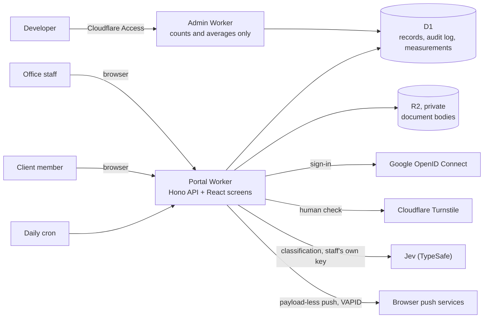

# Specification: komon-portal

The design rationale and the full requirements are in [`requirements.md`](../requirements.md) (Japanese). This folder holds the parts that describe the software as built:

- [`api/openapi.json`](api/openapi.json): every operation of the office Worker's API. A test (`test/api/docs/api-docs.test.ts`) fails when a route is added or removed without this file changing.

## Components



The admin Worker has no route to R2, to the Jev key or to document bodies.

## Publishing a document

```mermaid
sequenceDiagram
  participant S as Staff
  participant P as Portal Worker
  participant D as D1
  participant R as R2
  participant C as Client member
  S->>P: upload one file (per request)
  P->>P: check type, size and content; compute SHA-256
  P->>D: duplicate of a copy the client holds?
  P->>R: store body under a generated key
  P->>D: record (state Staged or NeedsReview, with evidence)
  S->>P: assign and stage (confirmation where another client holds the content)
  S->>P: publish (one result per file)
  P->>D: state Published, audit entry, notification
  P-->>C: payload-less push (if subscribed)
  C->>P: open the file (two requests, see Opening a file)
```

A failure at a step leaves the record as it was, and the result for that file says why. Publishing and withdrawing write the new state and the audit entry as one atomic step: if the entry cannot be written, the file is not published or withdrawn (in a batch publish that file is reported as not recorded and the others are still published). A case state change made by the system is stored with its audit entry in the same way. One known exception, listed in the README: what follows a publish is best-effort, so when the measurement event or the update of the linked case (with that update's own audit entry) fails, the file is still published and its result carries a warning. For a withdrawal only the measurement event is best-effort.

## Opening a file

Opening takes two requests. The first records the view and answers with a ticket; the second returns the body only with that ticket. When the user cannot read the file, both requests answer as if the file did not exist.

```mermaid
sequenceDiagram
  participant U as User (client member or staff)
  participant P as Portal Worker
  participant D as D1
  participant R as R2
  U->>P: POST /api/files/{id}/open (mode view or download)
  P->>P: check the session, the same-origin and CSRF rules, and that the user may read the file
  P->>R: check that the body exists (the body is not read)
  P->>D: client member: first-view receipt, only the first time; case confirmed
  P->>D: staff: acknowledgement of a client's submission, if not yet acknowledged
  P->>D: audit entry (file.view or file.download, or file.receive for a first receipt)
  P-->>U: ticket (expiry and signature)
  U->>P: GET /api/files/{id}/content?ticket=...
  P->>P: check the session, that the user may read the file, and the ticket
  P->>R: read the body
  P-->>U: body as attachment, never cached
```

- The ticket is valid for 60 seconds, for the same session, user and file. It is an HMAC-SHA256 signature, keyed with the session secret, over the user, the file and the expiry time. Nothing is stored for it, and it is not used up by the download, so it can be used again until it expires.
- The ticket is returned only after the open has succeeded. A failure part way through the open returns no ticket, so no body can be downloaded for it.
- The download writes nothing when it succeeds. It writes an audit entry only for a refusal because the user may not read the file, or a failure because the body is missing. A missing or wrong ticket for a file the user may read is refused and writes nothing. For a file the user may not read, the request is refused as a denial first and that denial is audited, as above.
- The first view by a client member is the receipt, recorded once per file and user. Views by staff are never receipts.
- The body is sent with `Content-Disposition: attachment` and a generated file name, and with `Cache-Control: no-store`.

## Time

The `Clock` port (`src/core/ports/clock.ts`) has one method, `now()`, which returns the current instant. The `SystemClock` adapter implements it. The calendar day is not taken from the port: `DeadlineCalculator.today(setting)` converts `now()` to a day in the office time zone and the deadline arithmetic is done in calendar days in code. The class diagram in `requirements.md` (section 5) shows a `Clock.today(timezone)` method; that method is not built.
