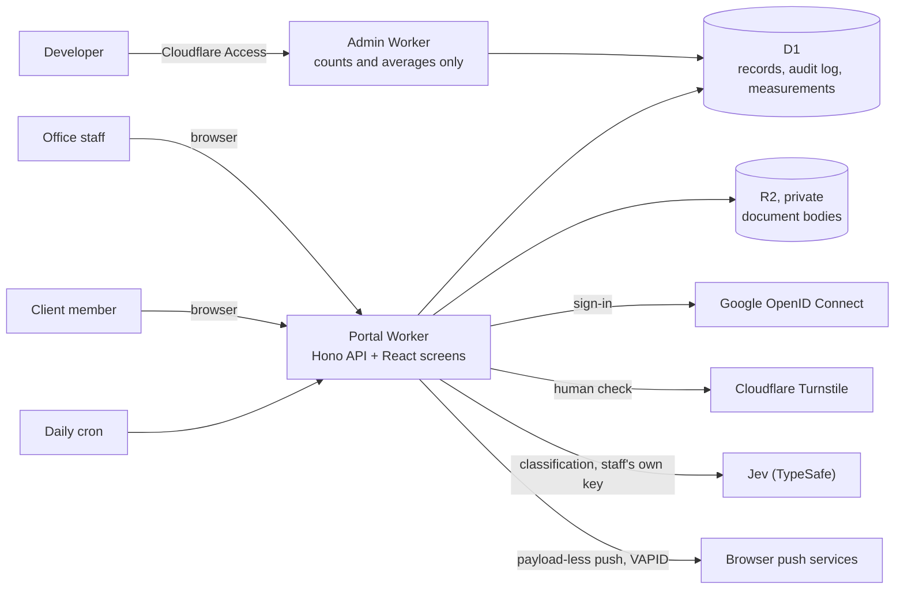

# Specification: komon-portal

The design rationale and the full requirements are in [`instructions.md`](../instructions.md) (Japanese). This folder holds the parts that describe the software as built:

- [`api/openapi.json`](api/openapi.json): every operation of the office Worker's API. A test (`test/api/docs/api-docs.test.ts`) fails when a route is added or removed without this file changing.

## Components



The admin Worker has no route to R2, to the Jev key or to document bodies.

## Publishing a document

```mermaid
sequenceDiagram
  participant S as Staff
  participant P as Portal Worker
  participant D as D1
  participant R as R2
  participant C as Client member
  S->>P: upload one file (per request)
  P->>P: check type, size and content; compute SHA-256
  P->>D: duplicate of a copy the client holds?
  P->>R: store body under a generated key
  P->>D: record (state Staged or NeedsReview, with evidence)
  S->>P: assign and stage (confirmation where another client holds the content)
  S->>P: publish (one result per file)
  P->>D: state Published, audit entry, notification
  P-->>C: payload-less push (if subscribed)
  C->>P: open the file
  P->>D: first-view receipt, audit entry
```

A failure at a step leaves the record as it was, and the result for that file says why. Publishing and withdrawing write the new state and the audit entry as one atomic step: if the entry cannot be written, the file is not published or withdrawn (in a batch publish that file is reported as not recorded and the others are still published). A case state change made by the system is stored with its audit entry in the same way. One known exception, listed in the README: what follows a publish is best-effort, so when the measurement event or the update of the linked case (with that update's own audit entry) fails, the file is still published and its result carries a warning. For a withdrawal only the measurement event is best-effort.
