# komon-portal 設計書（ウェブ／MVP／OSS）

リポジトリ名：`komon-portal`

---

## 1. 仕様書

### 1.1 前提の明記

| 項目 | 内容 |
|---|---|
| 対象エディション | MVP（需要調査）。デザインあり・測定あり・保守なし・監視なし |
| プラットフォーム | ウェブ。理由：成果物を直接操作するのは事務所職員と顧問先担当者（人間）であり、利用者の操作に応じて表示と保存内容が変わる |
| 公開形態 | OSS。理由：セキュリティそのものを提供価値として販売するサービスではなく、事務所が自分の環境で運用する業務基盤であるため。リポジトリは公開、ライセンスはMIT（リポジトリ直下に `LICENSE`）。アプリに課金の仕組みを組み込まない。収益は保守契約で得る |
| 導入単位 | 1デプロイ＝1事務所。事務所ごとに自分のCloudflareアカウントへ配置する。複数の職員・複数の顧問先担当者が同時に使う（マルチユーザー） |
| AI | 分類器としてJevのみを使う。BYOK（利用者のJevキー）。開発者はキーを持たない。文章生成AIは使わない |
| Jevのモデル | バージョン固定（方針の起点 `jev-1.13.0`）。エイリアス `jev-latest` は受け付けない。モデル・料金・上限は実装着手時に公式ページ（docs.typesafe.ai/models、/primitives、/confidence、/model-jaggedness/jev-1.13）で確認し、確認日を本欄に追記する |
| 画面の言語 | 英語のみ。文言は `src/locales/en.json` に分け、言語パックを後から追加できる構造とする。文書種別・手続種別の名称はマスターデータであり、事務所が日本語で登録できる |

### 1.2 解決する課題

> **文書が1件届くたびに、職員が「どの顧問先のものか」を目で判断し、名前を付け替え、保存し、送り、届いたかを確かめている。この手作業は顧問先数に比例して増え、取り違えると誤送付になる。**

本システムが担う関数は次の1つとする。

> **届いた文書を、取り違えなく正しい顧問先の棚に置き、顧問先が受け取ったことを記録として残す。**

この関数の副産物として、手続の進捗（申請した→公文書が来た→渡した→相手が見た）が人の入力なしで更新される。

### 1.3 利用者と権限

| 役割 | 誰か | できること |
|---|---|---|
| Owner | 事務所の責任者 | Staffの全操作、職員の招待と承認、事務所設定、監査ログの閲覧、顧問先の閉鎖 |
| Staff | 事務所職員 | 全顧問先の棚と案件の閲覧・操作、文書の投入・確認・公開・取り下げ、顧問先担当者の招待と承認 |
| Client Member | 顧問先の担当者 | 自社の棚にある公開済み文書の閲覧・ダウンロード、自社から事務所への資料の提出、自社案件の状態の閲覧 |
| Developer | 保守契約先 | 別Workerの管理画面（Cloudflare Accessで保護）から、稼働状況と測定値の閲覧。文書の中身は閲覧できない |

- 権限判定は Domain Core の1つの関数（AccessPolicy）に集約し、画面・API・定期処理のすべてがこれを通る。
- Client Member は、所属が承認済み（Active）の顧問先のデータにのみ到達できる。顧問先IDを書き換えた要求は、存在の有無を示さず一律に「見つからない」と応答する。
- 1つのGoogleアカウントが複数の顧問先に所属できる（グループ会社の担当者）。画面上部で顧問先を切り替える。職員と顧問先担当者の兼任は認めない。

### 1.4 個人情報の取り扱い

| 対象 | 方針 |
|---|---|
| 利用者の識別 | Googleログインの `sub` のみ保持する。メールアドレスは取得しない（要求スコープは `openid profile`）・保存しない |
| 表示名 | Googleアカウントの表示名のみ使う。システム内で氏名・ニックネームを入力させない |
| 生年月日・住所・電話番号 | 項目を持たない |
| 顧問先 | 法人名・顧問先コード・法人番号（法人の識別子であり個人情報ではない）を保持する。個人事業主を登録する場合は屋号と顧問先コードのみとし、代表者氏名を入力させない |
| 案件 | 自由記述欄を持たない。識別は「手続種別＋対象月＋連番」と、英数字・ハイフンのみの参照コードで行う（従業員氏名を書き込めない構造にする） |
| 保管ファイルの中身 | 事務所と顧問先の業務記録としてそのまま保管する。システムは中身から人を識別する項目を抽出・索引化・表示しない。読み取るのは到達番号と法人の識別子だけである |
| 元のファイル名 | 保存しない。表示名・ダウンロード名はシステムが生成する（従業員氏名入りのファイル名を画面と記録に残さない） |
| マイナンバー | 個人番号を含む文書は投入禁止とする。投入画面と顧問先の提出画面に常時表示する |
| Jevへ送る文字列 | 文書の様式名・通知名に相当する文字列のみ。本文・添付の中身は送らない |
| 記録類 | 監査ログ・測定イベントは `sub` と内部IDのみで記録する。IPアドレスは保存しない |

### 1.5 機能一覧

**事務所側**

| 画面（表示名） | 機能 |
|---|---|
| Dashboard | 要確認の件数、公開待ちの件数、公文書の取得期限が近い案件、未読のまま日数が経った文書、期限が近い案件 |
| Intake | ファイル・フォルダのまとめ投入。投入先の顧問先を指定する／しないを選べる。結果を1件ずつ表示 |
| Review | 自動で確定できなかった文書の一覧。理由の表示、顧問先・案件・種別の指定 |
| Staged | 公開待ちの一覧。まとめて公開 |
| Clients | 顧問先の登録・編集（コード、法人名、法人番号、状態）、担当者の招待・承認・解除 |
| Shelf | 顧問先別の棚。種別・対象月・案件で絞り込み。既読状況の表示。取り下げ |
| Cases | 案件の登録・一覧・状態。到達番号の登録。期限表示 |
| Settings | 文書種別と判定ルール、手続種別、到達番号の書式、取得期限日数、自動公開の有無、Jev（BYOK）設定、通知 |
| Audit Log | 操作記録の閲覧（Ownerのみ） |

**顧問先側**

| 画面（表示名） | 機能 |
|---|---|
| Home | 新着（未読）文書、自社案件の状態 |
| Documents | 自社の棚。種別・対象月で絞り込み。閲覧・ダウンロード |
| Send Files | 事務所への資料提出（給与資料など）。種別と対象月を選ぶ |
| Notifications | ブラウザ通知の許可・解除 |

**共通**：Sign in（Googleログイン）、Redeem Invitation（招待コードの入力。Turnstile必須）、Open-source notices（ライセンス表示、Jevの利用規約の説明）。

### 1.6 中核ロジック：文書の受け入れ・振り分け・公開

#### 1.6.1 設計原則

1. **宛先（顧問先）の決定にAIを使わない。** 顧問先は、完全一致する識別子か、人の明示的な指定だけで決まる。
2. **手がかりが食い違ったら必ず止める。** 2つの手がかりが別の顧問先を指した時点で自動処理をやめ、人の確認に回す。
3. **顧問先に見えるのは「公開済み」だけ。** 公開前のどの状態も、顧問先側からは存在しないものとして扱う。
4. **推測で補わない。** 判定できないものは「未分類」「要確認」として残し、もっともらしい値を入れない。
5. **Jevは文書種別のラベル付けだけに使う。** 確信度が閾値未満なら人に回す。Jevが止まっても受け入れ・振り分け・公開は続けられる。
6. **計算・日付比較・公開可否の最終判断はコードで行う。**

#### 1.6.2 受け入れ（1ファイルごと）

1. **形式の確認**
   - 0バイト、上限（1ファイル50MB）超過、許可外の形式は受け付けない。許可形式：PDF、ZIP、XML、CSV、XLSX、DOCX、TXT、PNG、JPEG。
   - 拡張子と先頭バイトの形式が食い違うものは受け付けない。
   - 受け付けなかったファイルは保存せず、理由を結果一覧に表示する。同じ投入の他のファイルは処理を続ける。
2. **ZIPの扱い**
   - ZIPは原本のまま1件として保管する（公文書一式の原本性を保つため、中身を別ファイルに分解して保管しない）。
   - 識別子の読み取りのために中の一覧と指定のXMLだけを読む。上限：エントリ200件、展開後合計200MB、入れ子のZIPは読まない。
   - 上限超過・暗号化・破損で中を読めないZIPは、識別子なしとして扱う（保管は可能、振り分けは人の指定による）。
   - エントリ名は読み取りにのみ使い、パスとして使わない。
3. **重複の確認**（内容のSHA-256による）
   - 同じ顧問先に同じ内容が既にある → 保存せず、既存の場所を結果一覧に示す。
   - 別の顧問先に同じ内容が既にある → 保存したうえで要確認に回す（理由：`DuplicateAcrossClients`）。
4. **識別子の読み取り**（ファイル名と、ZIP内のエントリ名・指定XMLから）
   - 到達番号：設定の書式に一致する文字列。e-Govの申請控えは「到達番号.zip」の名前で保存されるため、ファイル名が最有力の出どころになる。
   - 顧問先コード：ファイル名の先頭にある、登録済みコードと完全一致する区切り付きの語。
   - 法人番号：13桁で検査数字が正しく、登録済みの顧問先1社とだけ一致するもの。
5. **顧問先の決定**（上から順に評価）

   | 順 | 条件 | 結果 |
   |---|---|---|
   | a | 読み取った識別子が、互いに異なる顧問先を指す | 要確認（`ConflictingKeys`） |
   | b | 異なる到達番号が2つ以上ある | 要確認（`MultipleArrivalNumbers`） |
   | c | 到達番号が登録済みの案件と一致する | その案件の顧問先と案件に確定（方法：`ArrivalNumber`） |
   | d | 顧問先コードが一致する | その顧問先に確定（方法：`ClientCode`） |
   | e | 法人番号が1社と一致する | その顧問先に確定（方法：`CorporateNumber`） |
   | f | 投入時に顧問先を指定している | その顧問先に確定（方法：`StaffSelected`） |
   | g | 上のいずれでもない | 要確認（`NoKey`） |

   確定後の追加判定：
   - c〜e で決まった顧問先と、投入時の指定が異なる → 要確認（`HintMismatch`）。
   - 決まった顧問先が Active でない → 要確認（`ClientNotActive`）。
   - 一致した案件が Cancelled → 要確認（`CaseCancelled`）。
   - 到達番号の書式には合うが案件が未登録で、f により顧問先が決まった → 公開待ちに置き、案件の新規登録を画面で促す。
6. **文書種別の決定**
   - まず判定ルール（語句→種別の対応表。事務所が編集できる）を当てる。一致が1種別ならその種別。複数の種別に一致したら未分類。
   - ルールで決まらず、利用者のブラウザにJevキーが設定されている場合のみ、Jev（Choice）に様式名の文字列を渡して種別を選ばせる。確信度が閾値（既定0.90、設定で引き上げ可・0.80未満には下げられない）以上なら種別を付け、判定元を `Jev` と記録する。閾値未満なら未分類とし、候補を確認画面に示す。
   - Jevキーが無い場合は未分類のまま進む。
   - 種別が未分類であること自体は公開を妨げない（顧問先の決定とは独立）。ただし自動公開の対象からは外れる。
7. **状態の決定**
   - 顧問先が確定 → `Staged`（公開待ち）。
   - 確定できない → `NeedsReview`（要確認）。理由コードを付ける。
8. **表示名の生成**：`{顧問先コード}_{種別の短縮名または UNCLASSIFIED}_{受入日 YYYYMMDD}_{その日の連番}`。受入日は事務所のタイムゾーンで決める。

#### 1.6.3 確認（要確認の解消）

- 職員が顧問先（必須）・案件（任意）・種別（任意）を指定すると `Staged` に移る。方法は `StaffSelected` と記録する。
- 理由が `DuplicateAcrossClients`・`ConflictingKeys`・`HintMismatch` の場合は、食い違いの内容を表示し、確認のチェックを入れないと確定できない。
- 不要なファイルは破棄（`Trashed`）できる。

#### 1.6.4 公開

- 職員が公開待ちの一覧から選んでまとめて公開する。1件ずつ、公開の瞬間に次を再確認する：状態が `Staged` のままか、顧問先が Active か、記録の版が読み込み時と同じか。満たさないものは公開せず、理由とともに残す（他の件は公開する）。
- 公開すると顧問先の棚に現れ、その顧問先の通知許可済みの端末にブラウザ通知を送る。通知の文面は「新しい文書があります」のみで、文書名・種別を含めない。
- **自動公開**（既定は無効）：有効にした場合、決定方法が `ArrivalNumber`、種別が決定済み、顧問先が Active の3つをすべて満たすものだけを、受け入れ直後に公開する。それ以外は常に職員の操作を要する。
- 公開済みの文書の顧問先・案件は変更できない。変更するには取り下げてからやり直す。

#### 1.6.5 閲覧と受領の記録

- 文書の本体は非公開のR2に置き、URLを直接配らない。閲覧・ダウンロードは毎回Workerが権限を判定してから中継し、応答はキャッシュさせない。
- 顧問先担当者が初めて開いた時刻と `sub` を受領として記録する（文書ごと・利用者ごとに1回）。職員の閲覧は受領に数えない。
- 職員の棚には「未読／既読（誰がいつ）」を表示する。

#### 1.6.6 取り下げ

- 公開済みの文書は取り下げできる。理由の選択が必須（`WrongClient`／`WrongFile`／`Superseded`／`Other`）。
- 取り下げた瞬間から顧問先側では見えなくなる。開いたままの画面からのダウンロードも拒否する。
- 既に受領記録がある文書を `WrongClient` または `WrongFile` で取り下げた場合、誤送付として印を付け、閲覧した利用者と時刻を Owner の Dashboard に表示する。
- 取り下げた文書は `NeedsReview` に戻すか、破棄するかを選ぶ。

#### 1.6.7 顧問先からの提出

- 顧問先担当者は、種別と対象月を選んでファイルを提出する。形式・サイズ・重複の確認は 1.6.2 の 1〜3 と同じ。宛先は提出者の所属顧問先に固定され、他社を指定する手段を持たない。
- 提出された文書は、提出した顧問先の全担当者と事務所の全職員に見える（状態 `Submitted`）。職員が初めて開くと `Acknowledged` になり、提出者側に「事務所が確認済み」と表示される。
- 対象月と種別が一致する未完了の月次案件が1件だけあれば、その案件に結び付ける。0件または2件以上なら結び付けず、職員が指定する。
- 提出者は、`Acknowledged` になる前に限り自分の提出を取り消せる。

#### 1.6.8 破棄と消去

- 破棄した文書は30日間ごみ箱に残り、その間は元の状態に戻せる。30日を過ぎたものは定期処理（Cron Triggers、1日1回）が本体と記録を消去する。消去した事実（内部ID・時刻・実行者）は監査ログに残す。
- 公開済みの文書は直接破棄できない（取り下げを経る）。

### 1.7 案件と進捗

- 案件は「顧問先・区分（Procedure／Payroll／Other）・手続種別・対象月・参照コード・担当職員・期限日・申請日・到達番号（0件以上）」を持つ。
- 状態は文書の動きから自動で進む。手で進めるのは「申請した（申請日と到達番号の登録）」「完了にする」「取り消す」だけである。

| 状態 | 進む条件 |
|---|---|
| Open | 登録時 |
| Submitted | 申請日を登録した（Procedure） |
| MaterialsReceived | 顧問先の提出が結び付いた（Payroll） |
| DocumentReceived | 案件に結び付く文書を受け入れた |
| Delivered | 結び付く文書が1件以上公開された |
| Confirmed | 公開した文書を顧問先担当者が1件以上開いた |
| Closed | 職員が完了にした（文書を伴わない案件を含む） |
| Cancelled | 職員が取り消した |

- 公開済みの文書がすべて取り下げられたら `Delivered`／`Confirmed` から `DocumentReceived` に戻る。結び付く文書が0件になったら、申請日があれば `Submitted`、なければ `Open` に戻る。
- 顧問先側には、自社案件の区分・種別・対象月・状態だけを表示する（担当職員・期限日・参照コードは表示しない）。
- **公文書の取得期限**：e-Govの公文書は取得できる期間に限りがある（API連携ソフト経由は申請後90日、e-Govアプリ経由は審査終了の通知後90日）。本システムは短い側に合わせ、取得期限を「申請日＋設定日数（既定90日）」として計算する。`Submitted` のまま文書が届いていない案件について、残り30日以下を注意、残り10日以下を警告、超過を期限切れとして Dashboard に表示する。
- **案件の期限**：期限日まで7日以下を注意、超過を期限切れとして表示する。
- 日付の計算はすべて事務所のタイムゾーン（設定。既定 Asia/Tokyo）の暦日で行う。

### 1.8 招待と所属

- メールアドレスを保持しないため、招待は「招待リンク（1回限りのコードを含む）」で行う。職員がリンクを発行し、事務所の既存の連絡手段で相手に渡す。
- 招待コードは推測できない長さの乱数とし、サーバーにはハッシュのみ保存する。有効期間72時間、1回限り、対象（顧問先または事務所）と役割に固定する。
- 相手がGoogleでログインしてコードを使うと、所属は `Pending` になる。この時点では何も閲覧できない。
- 職員（事務所への招待はOwner）が、表示名と使用時刻を見て承認すると `Active` になる。心当たりがなければ拒否する。リンクが別人に渡っても、承認されない限り何も見えない。
- 期限切れ・使用済み・取り消し済み・存在しないコードは、区別せず同じ文言で断る。
- 所属の解除は即時に効く。その利用者の全セッションを失効させる。
- **初回設定**：デプロイ時に環境変数で渡した初期設定トークンを、最初にログインした利用者が入力するとOwnerになる。Ownerが1人でも存在すれば、このトークンは無効になる。Ownerは常に1人以上必要で、最後の1人は解除できない。

### 1.9 Jev（BYOK）

| 項目 | 仕様 |
|---|---|
| 用途 | 文書種別の選択（Choice）のみ |
| キーの保存 | 職員のブラウザ内のみ。サーバー（D1・R2・ログ）に保存しない |
| キーの受け渡し | 要求ごとにブラウザからWorkerへ渡し、Workerはその1回の呼び出しにだけ使う。応答・エラー・ログに出力しない |
| 通信先 | TypeSafeのAPIのみ |
| モデル | 利用者がバージョン名を入力する。エイリアス（`-latest`）は入力時に拒否する。アプリは推奨モデル・単価・推定額を表示しない。料金は公式ページへのリンクで案内する |
| 呼び出しのまとめ | 1回の投入で種別が決まらなかった文書を、1回の呼び出しの `questions` に並べる。1回の上限は50件とし、超える分は次の呼び出しに分ける |
| 送る内容 | 様式名・通知名に相当する文字列と、種別の選択肢。到達番号・顧問先コード・6桁以上の数字列は除く |
| 記録 | 応答の `model`、確信度、採否を文書ごとに記録する |
| 失敗時 | 未対応のモデル名・認証エラー・上限到達・通信失敗は、エラーを表示して種別判定を止める。別モデルや別方式に切り替えない。文書は未分類のまま残り、振り分けと公開は影響を受けない |
| 案内 | 利用上限は利用者がプロバイダー側で設定する旨と、プロバイダーの利用規約（データ利用の扱い）を Settings と Open-source notices に記載する |

### 1.10 セキュリティ要件

- 認証：Googleログイン（OpenID Connect）。セッションはサーバー側（D1）で管理し、Cookieは HttpOnly・Secure・SameSite=Lax。無操作60分または発行から12時間で失効する。
- 状態を変える要求には、同一オリジンの確認とCSRFトークンを要求する。
- 公開の入力画面（Redeem Invitation、初回設定）はTurnstileを必須とする。
- 応答ヘッダー：Content-Security-Policy（外部スクリプトは Google ログインと Turnstile のみ許可）、X-Content-Type-Options、Referrer-Policy、frame-ancestors 'none'。
- 文書の配信は `Content-Disposition: attachment` と生成したファイル名で行い、ブラウザ内で実行される形で返さない。
- 記録の更新は版番号による楽観的排他で行う。2人が同じ文書を同時に操作した場合、後の操作は拒否して再読み込みを求める。
- 監査ログは追記のみ。画面・APIから変更・削除する手段を持たない。対象：ログイン、招待の発行・使用・承認・拒否、所属の解除、文書の受け入れ・確定・公開・閲覧・ダウンロード・取り下げ・破棄・消去、案件の変更、設定の変更、拒否された要求。
- 秘密情報（Googleのクライアントシークレット、Turnstileの秘密鍵、初期設定トークン、Web Pushの秘密鍵）は環境変数で渡し、リポジトリに含めない。
- 開発者用の管理画面は別Workerとし、Cloudflare Accessで保護する。文書本体とJevキーに到達する経路を持たない。

### 1.11 デザイン要件

- 方針：書類棚としての落ち着きと、取り違えを起こさない明瞭さ。装飾より状態の読み取りやすさを優先する。
- 配色：地は白と淡い灰。主色は濃紺。状態色は4つに限定する（公開済み＝緑、公開待ち＝青、要確認＝橙、取り下げ・期限切れ＝赤）。色だけに頼らず、必ず語とアイコンを併記する。
- 顧問先の取り違え防止：職員側の棚・確認・公開の各画面では、対象の顧問先コードと法人名を画面上部に固定表示する。まとめて公開する確認画面では、顧問先ごとに件数をまとめて表示する。
- 顧問先側は1カラムで、新着を最上部に置く。スマートフォンの幅でも閲覧とダウンロードができる。
- 事務所側は左に固定メニュー、右に一覧。一覧は顧問先が数百社になっても使えるよう、絞り込みとコード検索を常に表示する。
- 操作の結果（受け入れ結果、公開の成否）は1件ずつ理由付きで表示し、まとめて「完了」とだけ表示しない。

### 1.12 測定（運用要件）

目標値は定めない。次を計測する。

| 測定軸 | 取得方法 |
|---|---|
| ページの閲覧数・画面別の利用 | Cloudflare Web Analytics（Cookieを使わない） |
| 週ごとの利用顧問先数・利用職員数 | 測定イベント（D1） |
| 受け入れ件数、決定方法別の内訳、要確認の理由別の内訳 | 測定イベント |
| 受け入れから公開までの時間、公開から初回閲覧までの時間 | 文書の時刻の差 |
| 職員による顧問先・種別の修正件数 | 測定イベント |
| 取り下げ件数（理由別）、誤送付の件数 | 測定イベント |
| 顧問先からの提出件数 | 測定イベント |
| Jevの判定件数、確信度の分布、採否 | 文書ごとの記録 |
| 取得期限の警告が出た案件数と、その後の結果 | 案件の状態履歴 |

測定イベントは内部IDのみで記録し、表示名・ファイル名を含めない。

### 1.13 構成

| 層 | 採用 |
|---|---|
| 画面とAPI | Cloudflare Workers。TypeScript（strict）。Hono（API）＋React（画面、Workers Static Assetsで配信） |
| データ | D1 |
| ファイル | R2（非公開バケット） |
| 定期処理 | Cron Triggers（ごみ箱の消去、期限切れ招待の整理） |
| 通知 | Web Push（VAPID） |
| Bot対策 | Turnstile |
| 開発者用管理画面 | 別Worker＋Cloudflare Access |
| CI | 型チェックとテストを必須にする |

料金と上限（Workersの要求本体サイズ、D1・R2の容量、Access・Turnstileの無料枠）は、採用時点の公式ページで確認してから使う。

**リポジトリ構成**

```text
komon-portal/
├─ LICENSE                 MIT
├─ README.md               導入手順（自分のCloudflareアカウントへの配置）
├─ src/
│  ├─ core/                Domain Core（純粋なTypeScript。Cloudflare・HTTP・画面に依存しない）
│  │  ├─ intake/           形式確認・識別子の読み取り・顧問先の決定・種別の決定
│  │  ├─ publish/          公開・取り下げ・受領
│  │  ├─ cases/            案件の状態・期限計算
│  │  ├─ access/           権限判定・招待・所属
│  │  └─ ports/            保存先・ファイル置き場・時計・分類器・通知の接続口（型のみ）
│  ├─ app/                 利用者向けWorker
│  │  ├─ api/              Hono。core を呼ぶ薄い層
│  │  ├─ adapters/         D1・R2・Jev・Web Push・Google・Turnstile の実装
│  │  ├─ web/              React の画面
│  │  └─ migrations/       D1 のスキーマ
│  ├─ admin/               開発者用Worker（Cloudflare Access の内側）
│  └─ locales/
│     └─ en.json           画面の文言
└─ test/                   core の単体テスト、API の結合テスト
```

Domain Core は接続口（ports）だけに依存する。別のインターフェース（API公開・CLI・MCP）が必要になった場合は、`src/core` を呼ぶ薄い層を足すだけで済む構造とする。

### 1.14 対象外

- e-Gov・申請ソフトからの公文書の自動取得
- メールによる通知（メールアドレスを保持しないため）
- マイナンバーを含む文書の取り扱い
- 文書の全文検索、中身の読み取り（OCR）、電子署名、承認ワークフロー
- 顧問先単位の一括書き出し（事務所は自分のR2に直接到達できる）
- 課金、稼働監視、リリース後の保守

---

## 2. ER図

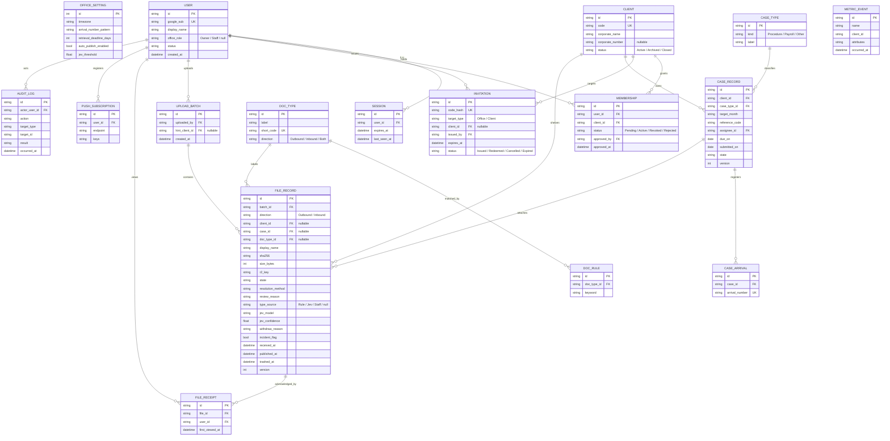

制約：

- `FILE_RECORD(client_id, sha256)` は、破棄済みを除き一意とする。
- `CASE_ARRIVAL.arrival_number` は全体で一意とする（1つの到達番号が2つの案件・2つの顧問先に属することを構造で防ぐ）。
- `MEMBERSHIP(user_id, client_id)` は、`Revoked`／`Rejected` を除き一意とする。
- `FILE_RECEIPT(file_id, user_id)` は一意とする。
- `FILE_RECORD.state` が `Published` の行は、`client_id` が必ず入っている。

---

## 3. DFD

### 3.1 コンテキスト図

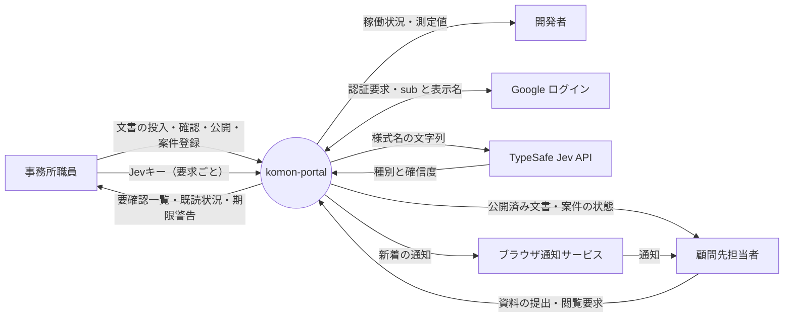

### 3.2 レベル1

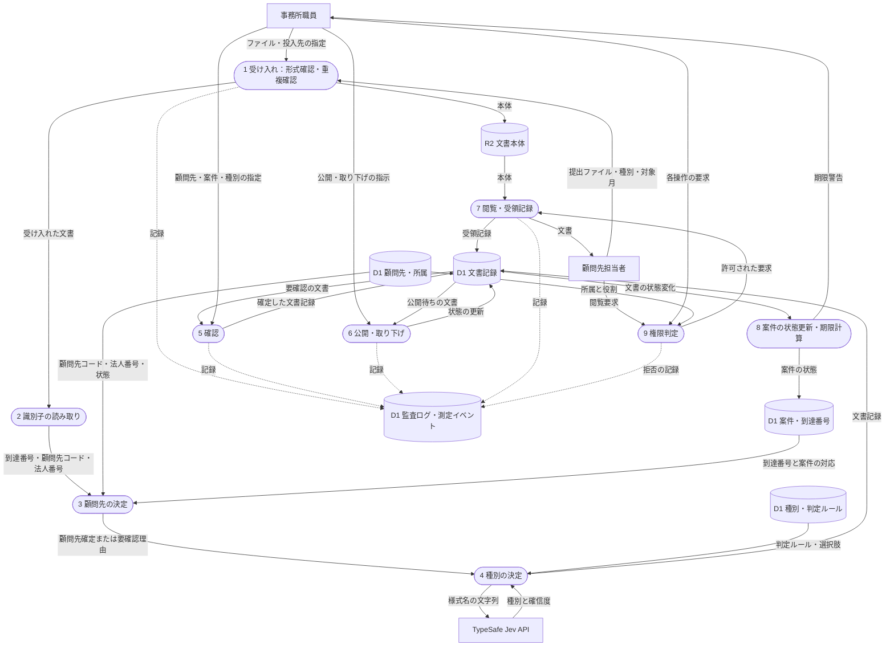

---

## 4. シーケンス図

### 4.1 公文書の投入から公開待ちまで

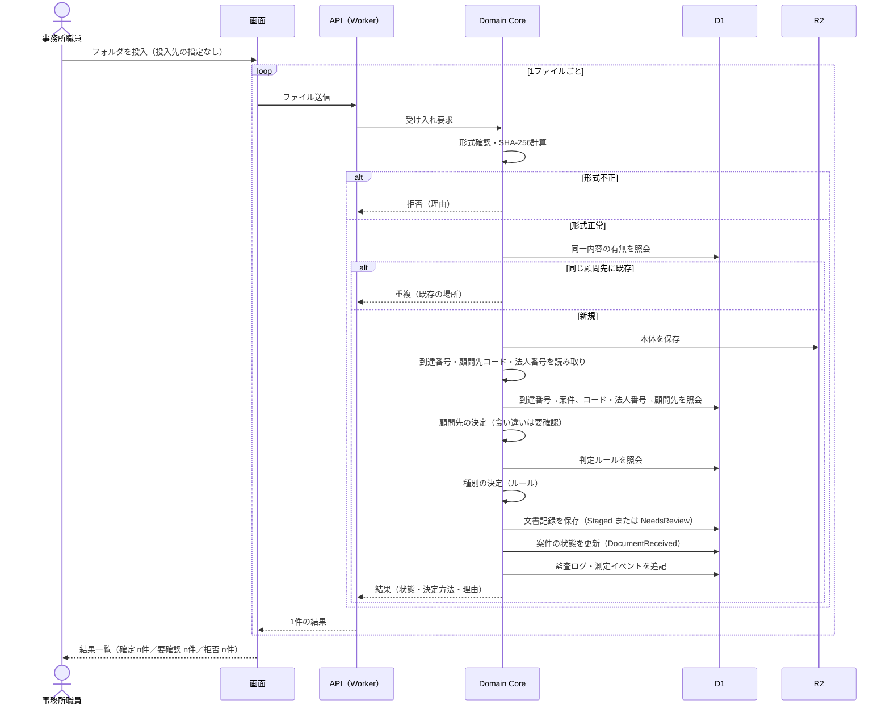

### 4.2 種別の判定（Jev・BYOK）

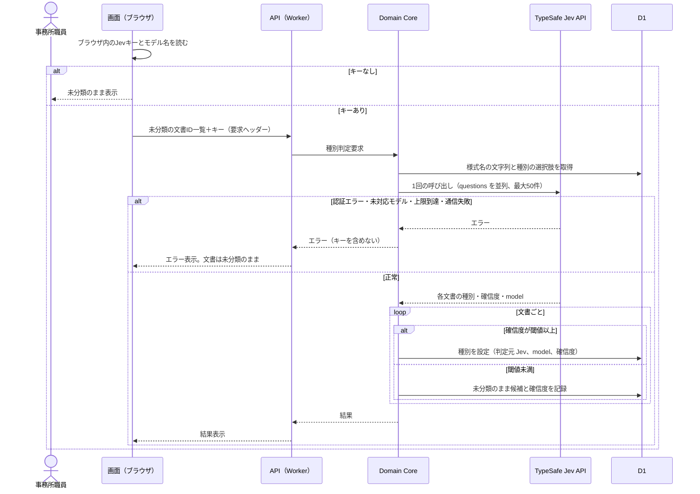

### 4.3 公開から受領まで

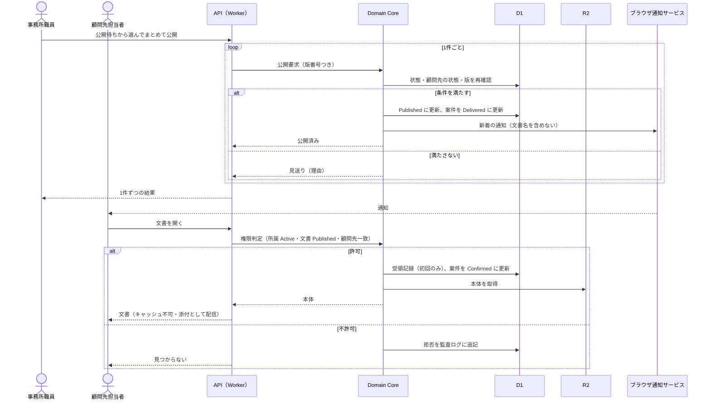

### 4.4 招待と承認

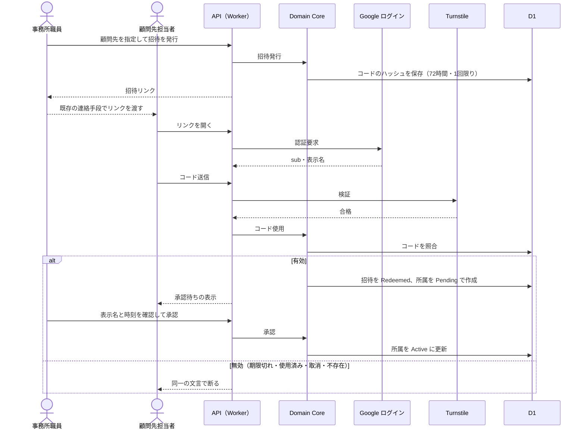

---

## 5. クラス図

```mermaid
classDiagram
    class IntakeService {
        +accept(file, uploader, hintClient) IntakeResult
        +submitFromClient(file, member, docType, month) IntakeResult
    }
    class FileValidator {
        +validate(file) ValidationResult
    }
    class KeyExtractor {
        +extract(file) ExtractedKeys
    }
    class ExtractedKeys {
        +arrivalNumbers
        +clientCodes
        +corporateNumbers
    }
    class ClientResolver {
        +resolve(keys, hintClient) Resolution
    }
    class Resolution {
        +clientId
        +caseId
        +method
        +reviewReason
    }
    class DocTypeDecider {
        +decideByRules(titleText) TypeDecision
        +decideByClassifier(items, credential) TypeDecision[]
    }
    class TypeDecision {
        +docTypeId
        +source
        +model
        +confidence
    }
    class ReviewService {
        +assign(fileId, clientId, caseId, docTypeId, actor, version)
        +trash(fileId, actor, version)
    }
    class PublishService {
        +publish(fileIds, actor) PublishResult[]
        +autoPublishIfEligible(fileId)
        +withdraw(fileId, reason, actor, version)
    }
    class ViewService {
        +open(fileId, actor) FileStream
    }
    class CaseService {
        +register(case, actor)
        +markSubmitted(caseId, date, arrivalNumbers, actor)
        +onFileEvent(event)
        +close(caseId, actor)
        +cancel(caseId, actor)
    }
    class DeadlineCalculator {
        +retrievalLevel(case, today) Level
        +dueLevel(case, today) Level
    }
    class AccessPolicy {
        +can(actor, action, resource) bool
    }
    class InvitationService {
        +issue(target, actor) InvitationLink
        +redeem(code, user)
        +approve(membershipId, actor)
        +reject(membershipId, actor)
        +revoke(membershipId, actor)
    }
    class AuditRecorder {
        +record(actor, action, target, result)
    }
    class MetricRecorder {
        +record(name, attributes)
    }
    class Repository {
        <<interface>>
    }
    class FileStore {
        <<interface>>
        +put(key, body)
        +get(key) FileStream
        +delete(key)
    }
    class ClassifierPort {
        <<interface>>
        +choose(items, choices, credential) ClassifierAnswer[]
    }
    class Notifier {
        <<interface>>
        +notifyNewDocument(clientId)
    }
    class Clock {
        <<interface>>
        +today(timezone)
        +now()
    }
    class D1Repository
    class R2FileStore
    class JevClassifier
    class WebPushNotifier
    class SystemClock

    IntakeService --> FileValidator
    IntakeService --> KeyExtractor
    IntakeService --> ClientResolver
    IntakeService --> DocTypeDecider
    IntakeService --> PublishService
    IntakeService --> CaseService
    IntakeService --> FileStore
    IntakeService --> Repository
    KeyExtractor --> ExtractedKeys
    ClientResolver --> Resolution
    ClientResolver --> Repository
    DocTypeDecider --> TypeDecision
    DocTypeDecider --> ClassifierPort
    ReviewService --> Repository
    ReviewService --> AccessPolicy
    PublishService --> AccessPolicy
    PublishService --> Notifier
    PublishService --> CaseService
    PublishService --> Repository
    ViewService --> AccessPolicy
    ViewService --> FileStore
    ViewService --> CaseService
    CaseService --> DeadlineCalculator
    CaseService --> Repository
    DeadlineCalculator --> Clock
    InvitationService --> AccessPolicy
    InvitationService --> Repository
    IntakeService --> AuditRecorder
    PublishService --> AuditRecorder
    ViewService --> AuditRecorder
    InvitationService --> AuditRecorder
    IntakeService --> MetricRecorder
    Repository <|.. D1Repository
    FileStore <|.. R2FileStore
    ClassifierPort <|.. JevClassifier
    Notifier <|.. WebPushNotifier
    Clock <|.. SystemClock
```

- 上段のサービスと値（`IntakeService`〜`MetricRecorder`）が Domain Core、`<<interface>>` が接続口、最下段がアダプタである。
- `ClientResolver` は `ClassifierPort` に依存しない（顧問先の決定に分類器が関与しないことを構造で保証する）。

---

## 6. 状態遷移図

### 6.1 事務所から顧問先への文書

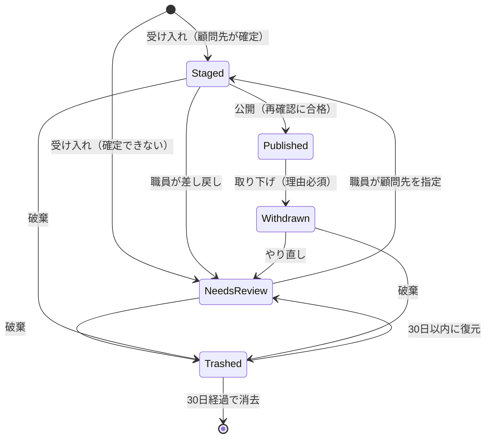

顧問先から見えるのは `Published` のみである。

### 6.2 顧問先から事務所への提出

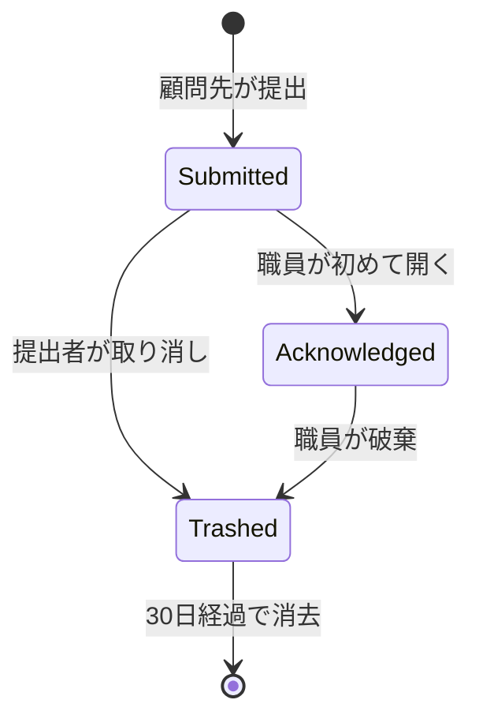

### 6.3 案件

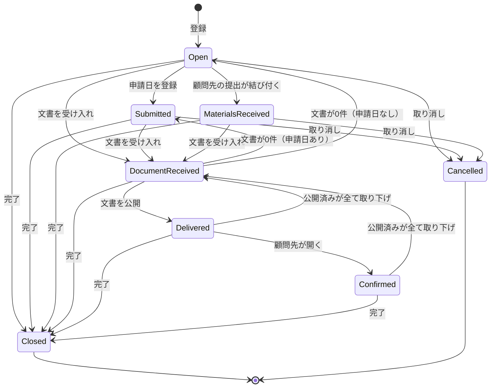

### 6.4 所属

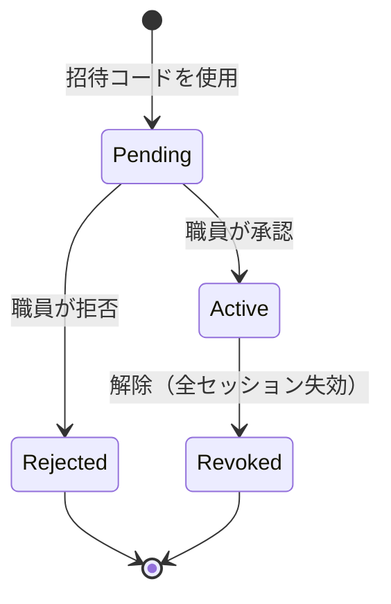

### 6.5 顧問先

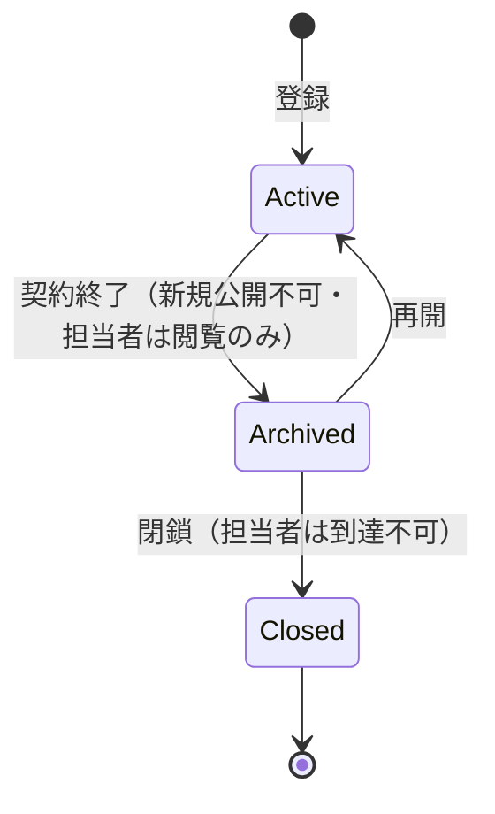

---

## 7. ユースケース図

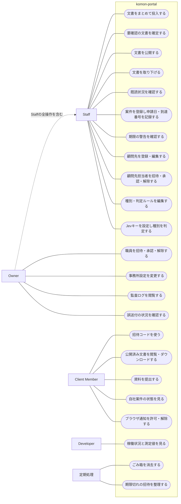
